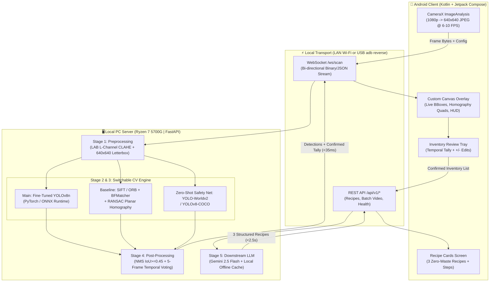

# Stock-to-Stove: Master Implementation Specification, Task Plan & Model Training Guide

> **Course:** CSST 106 — Computer Vision Final Project  
> **Team:** Kaggleing (Aron Gabriel L. Ogayon, Allain A. Kumar, Janvher Lucas J. Sarmiento)  
> **Target Platform:** Native Android Client + Local PC Inference Server (AMD Ryzen 7 5700G)

---

## Part I: System Architecture & Android Implementation Plan

### 1. Executive Architecture Summary
- **Mobile Client:** Native **Android (Kotlin + Jetpack Compose + CameraX)** targeting Android 8.0+ (API 26+).
- **Local Inference Server (This PC):** **Python FastAPI + Uvicorn (WebSockets + REST)** running on this machine (**AMD Ryzen 7 5700G, 8C/16T, 16 GB RAM, Radeon Vega 8 iGPU**).
- **Transport Layer:** Dual-mode **USB `adb reverse` (`127.0.0.1:8000`)** for zero-latency, Wi-Fi-independent classroom defense demos, plus **Local Wi-Fi LAN (`ws://<PC_IP>:8000`)** for untethered kitchen scanning (pantry shelves & refrigerators).



---

### 2. Target Monorepo Directory Structure

```text
stock2stove/
├── TASK.md                           # Master Specification, Task Plan & Training Guide
├── README.md                         # Project overview and quickstart
├── requirements.txt                  # Python dependencies (FastAPI, Ultralytics, OpenCV, GenAI)
├── android/                          # Native Android Client (Kotlin + Jetpack Compose)
│   ├── app/
│   │   ├── src/main/
│   │   │   ├── AndroidManifest.xml
│   │   │   ├── java/com/kaggleing/stock2stove/
│   │   │   │   ├── MainActivity.kt
│   │   │   │   ├── data/
│   │   │   │   │   ├── api/          # Retrofit REST client & OkHttp WebSocket manager
│   │   │   │   │   ├── local/        # DataStore (Server IP prefs) & Room (Scan history)
│   │   │   │   │   └── model/        # DTOs: FrameDetection, PantryItem, RecipeCard
│   │   │   │   ├── domain/           # UseCases & Repository interfaces
│   │   │   │   └── ui/
│   │   │   │       ├── theme/        # Material 3 Kitchen/Culinary Palette
│   │   │   │       ├── home/         # Server Connection Status & Quick Actions
│   │   │   │       ├── scanner/      # CameraX Preview, BBox Canvas Overlay, Defense HUD
│   │   │   │       ├── inventory/    # Post-Scan Verification BottomSheet
│   │   │   │       └── recipes/      # 3 Zero-Waste Recipe Cards & Cooking Checklist
│   │   └── build.gradle.kts
│   └── settings.gradle.kts
├── src/                              # Python CV Pipeline, Training & Local Inference Server
│   ├── server/
│   │   ├── app.py                    # FastAPI entrypoint (REST + WebSocket /ws/scan)
│   │   ├── schemas.py                # Pydantic request/response models
│   │   ├── session_manager.py        # Per-scan temporal voting state machine
│   │   └── config.py                 # Host/port, model paths, thresholds
│   ├── cv/
│   │   ├── preprocess.py             # LAB CLAHE shadow equalization + 640x640 letterbox
│   │   ├── baseline_detector.py      # Classical SIFT/ORB + BFMatcher/FLANN + RANSAC
│   │   ├── yolo_detector.py          # Fine-tuned YOLOv8n + YOLO-World/COCO fallback
│   │   └── temporal_tracker.py       # 5-frame sliding window voter + IoU deduplication
│   ├── training/
│   │   ├── extract_frames.py         # Extracts frames from pantry/fridge video pans
│   │   ├── auto_label.py             # Uses YOLO-World to pre-annotate home photos
│   │   ├── merge_datasets.py         # Remaps online Roboflow datasets to unified classes
│   │   ├── train_yolo.py             # Fine-tunes YOLOv8n and exports ONNX/PyTorch weights
│   │   └── evaluate_all.py           # Benchmarks SIFT/ORB vs YOLOv8n (mAP, Recall, FPS)
│   ├── spike.py                      # Milestone 1 feasibility spike
│   └── llm_recipe.py                 # Downstream structured JSON recipe engine + cache
├── data/
│   ├── samples/                      # 20 benchmark samples from images.cv
│   ├── templates/                    # Reference crops for SIFT/ORB baseline matching
│   ├── raw_home/                     # Your own 10+ pantry & refrigerator photos/videos
│   └── dataset_yolo/                 # Merged train/val/test split + pantry_fridge.yaml
└── models/                           # Weights (yolov8n_stock2stove.pt / .onnx, yolov8s-worldv2.pt)
```

---

### 3. Local PC Inference Server Specification (`src/server/` & `src/cv/`)

#### 3.1 Computer Vision Pipeline Modules
| Module | File | Implementation Specification |
| :--- | :--- | :--- |
| **1. Preprocessing** | `src/cv/preprocess.py` | Converts BGR frame to LAB color space, applies `cv2.createCLAHE(clipLimit=2.0, tileGridSize=(8,8))` to the $L$ channel (mitigating $<100\text{ lux}$ cupboard/fridge shadows), converts back to BGR, and applies aspect-preserving `640x640` letterbox padding. |
| **2. Classical Baseline** | `src/cv/baseline_detector.py` | Loads multi-angle reference crops (`data/templates/<class_id>/*.jpg`). Extracts ORB (`nfeatures=1000`) or SIFT keypoints, matches via `BFMatcher` / `FlannBasedMatcher` with Lowe's ratio test ($0.75$), and computes `cv2.findHomography(..., cv2.RANSAC, 5.0)`. Outputs bounding polygon quads + inlier count. |
| **3. Main Detector** | `src/cv/yolo_detector.py` | Wraps `ultralytics.YOLO`. Loads fine-tuned `models/yolov8n_stock2stove.pt` (or `.onnx`). Includes automatic zero-shot fallback to `yolov8s-worldv2.pt` (custom open-vocabulary prompts) if custom weights are not yet trained. |
| **4. Temporal Voter** | `src/cv/temporal_tracker.py` | Maintains a per-session deque of length $W = 5$ frames. An item class is promoted to `confirmed_inventory` only if detected with $\text{conf} \ge 0.50$ in at least $K = 3$ of the last $5$ frames. Estimates distinct item count using max simultaneous non-overlapping boxes ($\text{IoU} < 0.45$). |
| **5. Recipe Engine** | `src/llm_recipe.py` | Returns structured JSON (`List[RecipeCard]`) via Gemini 2.5 Flash / OpenAI. Enforces a strict `2.5s` timeout; on timeout or offline mode, immediately serves deterministic local recipes matched to the detected pantry & fridge items. |

#### 3.2 Real-Time WebSocket & REST API Contract
- **`WS /ws/scan` (Real-Time Camera Stream):**
  - **Client -> Server:** JSON/Binary frame (`frame_id`, `detector_mode: "yolov8" | "orb_baseline" | "sift_baseline" | "yolo_world"`, `enable_clahe: true`, `conf_threshold: 0.50`, `image_b64` or raw JPEG bytes).
  - **Server -> Client (<35 ms on Ryzen 7 5700G):**
    ```json
    {
      "frame_id": 42,
      "detector_mode": "yolov8",
      "inference_ms": 21.4,
      "fps": 46.7,
      "diagnostics": { "edge_density_pct": 15.8, "orb_keypoints": 412, "clahe_applied": true },
      "detections": [
        {
          "class_id": "pasta_box",
          "display_name": "Pasta Box",
          "confidence": 0.91,
          "bbox_norm": [0.12, 0.24, 0.38, 0.78],
          "polygon_norm": null,
          "temporally_confirmed": true
        }
      ],
      "confirmed_inventory": [
        {"class_id": "pasta_box", "display_name": "Pasta Box", "count": 1, "max_conf": 0.93},
        {"class_id": "tomato_can", "display_name": "Canned Tomatoes", "count": 2, "max_conf": 0.88}
      ]
    }
    ```
- **REST Endpoints:**
  - `GET /api/v1/health` — Server status, active model weights, CPU/GPU hardware info, supported classes.
  - `POST /api/v1/scan/image` — Runs **both** SIFT/ORB Baseline and YOLOv8n on one image and returns side-by-side comparison metrics for academic defense.
  - `POST /api/v1/scan/video` — Uploads a 5-second `.mp4` shelf/fridge pan and returns confirmed inventory + annotated keyframes.
  - `POST /api/v1/recipes/generate` — Generates 3 structured zero-waste recipes from confirmed pantry + refrigerator inventory.

---

### 4. Android Application Specification (`android/`)

#### 4.1 Screen-by-Screen UX
1. **Home & Connection Hub (`ui/home/`):**
   - Server Status Card with 1-tap presets: **USB `adb reverse` (`127.0.0.1:8000`)**, **Emulator (`10.0.2.2:8000`)**, or **Custom LAN IP (`192.168.x.x:8000`)**.
   - Mode selector: **Scan Pantry Shelf** or **Scan Refrigerator**.
2. **Live CameraX Scanner (`ui/scanner/`):**
   - Uses `ImageAnalysis.STRATEGY_KEEP_ONLY_LATEST` compressing 640×640 JPEG frames at 6–10 FPS.
   - Real-time `Canvas` overlay drawing bounding boxes (YOLO) or 4-point planar homography polygons (SIFT/ORB Baseline).
   - **Academic Defense Toggle Bar:** Switch live on screen between `YOLOv8n (Main)`, `ORB/SIFT (Baseline)`, and `YOLO-World (Zero-Shot)`, plus `CLAHE Low-Light Toggle` and a live telemetry HUD (`FPS`, `Inference ms`, `Edge Density`).
3. **Inventory Verification BottomSheet (`ui/inventory/`):**
   - Shows temporally confirmed items (`Confirmed in >=3/5 frames`), confidence badges, quantity steppers (`-` / `+`), and manual quick-add chips.
4. **Zero-Waste Recipe Cards (`ui/recipes/`):**
   - Displays 3 structured recipes with prep time, matched pantry/fridge items highlighted, interactive cooking steps, and LLM latency badge.

#### 4.2 Classroom Connectivity Protocol
- **Primary (USB Cable — Immune to Classroom Wi-Fi Blocks):**
  ```powershell
  & "$env:LOCALAPPDATA\Android\Sdk\platform-tools\adb.exe" reverse tcp:8000 tcp:8000
  ```
  Phone connects directly to `ws://127.0.0.1:8000/ws/scan` over USB (<2 ms latency).
- **Secondary (Wireless LAN / Windows Mobile Hotspot):** Phone connects to `ws://<PC_LAN_IP>:8000/ws/scan`.

---

## Part II: Do We Need to Train a Model? Complete Data Sourcing & Training Guide

### 1. Do We Need to Train a Model? (The Short Answer)

> [!IMPORTANT]
> **Two-Track Strategy: Build the App Now with Zero-Shot, Fine-Tune YOLOv8n for Your Course Grade**
> 1. **To build and test the Android app & server TODAY: NO training is needed.**
>    We can immediately run **`YOLO-Worldv2` (`yolov8s-worldv2.pt`)** on your PC. It is a pre-trained open-vocabulary detector where you simply list text prompts in Python (`["pasta box", "canned tomatoes", "cereal box", "coffee bag", "tuna can", "milk", "eggs", "cheese"]`) and it detects them out-of-the-box with zero training.
> 2. **To pass CSST 106 Checkpoints 3, 4, and 5 with top marks: YES, you must fine-tune `YOLOv8n`.**
>    Your CSST 106 syllabus and proposal require comparing a **Classical Baseline (SIFT/ORB)** against a **Fine-Tuned Deep Detector (`YOLOv8n`)** with training loss curves, validation $\text{mAP@0.5} \ge 0.85$, and occlusion recall benchmarks. Furthermore, fine-tuning on even a small number of your own pantry/fridge photos makes the model recognize **your exact local Filipino/household brands** (e.g., Century Tuna, San Marino, Del Monte, Argentina, Bear Brand, local pasta/cereal boxes) with 90%+ confidence!

---

### 2. Expanding Scope: Pantry Shelf + Refrigerator Classes

Including both your **Pantry Shelf** and **Refrigerator** is a great idea—it makes the recipes much richer (combining dry staples like pasta/canned goods with fridge staples like eggs/milk/cheese/vegetables) and makes it easier to photograph enough items at home!

We recommend **8 Core Unified Classes** (5 Dry Pantry + 3 Refrigerator staples) so your dataset stays balanced and hits $\ge 50$ instances per class easily:

| Class ID | Class Name | Storage Zone | Examples (Online + Your Home Photos) |
| :---: | :--- | :--- | :--- |
| `0` | `pasta_noodles` | Pantry | Barilla, Royal, Fiesta spaghetti/macaroni boxes or packs, instant noodles |
| `1` | `canned_tomato` | Pantry | Hunt's, Del Monte tomato sauce/paste/crushed cans or pouches |
| `2` | `canned_tuna_meat` | Pantry | StarKist, Century Tuna, corned beef, sardines, luncheon meat cans |
| `3` | `cereal_grains` | Pantry | Cheerios, Koko Krunch, oatmeal cartons, rice/flour packs |
| `4` | `coffee_condiment` | Pantry | Starbucks/Folgers/Nescafé bags or jars, cooking oil, soy sauce bottles |
| `5` | `milk_dairy` | Refrigerator | Fresh milk cartons, butter sticks, cheese blocks, yogurt cups |
| `6` | `eggs` | Refrigerator | Egg trays/cartons or loose eggs on the fridge door shelf |
| `7` | `fresh_produce` | Refrigerator | Tomatoes, onions, garlic, bell peppers, carrots, leafy greens in crisper |

---

### 3. Curated Online Datasets (Ready-to-Download YOLOv8 Bounding Boxes)

Because you only have ~10–15 photos of your own pantry and refrigerator, **80% of your training images (200–350 images) will come from pre-annotated online datasets**, and **20% (40–60 frames) will come from your own pantry/fridge photos & short video pans**.

Here are the best verified online datasets with **existing bounding-box annotations** you can download right now:

#### A. Pantry & Grocery Shelf Object Detection Datasets
1. **Roboflow Universe — Pantry Items (`iotfinalgroceries/pantry-items-eni0b`)**
   - **URL:** https://universe.roboflow.com/iotfinalgroceries/pantry-items-eni0b
   - **Contents:** Cluttered domestic pantry shelves with bounding boxes exported directly in `YOLOv8` format.
2. **Roboflow Universe — Pantry Object Detection (`pantry-wlooe`)**
   - **URL:** https://universe.roboflow.com/search?q=pantry-wlooe
   - **Contents:** 596 annotated images covering `canned tuna`, `canned corn`, `cereal`, `pasta` (elbow/spaghetti), `spaghetti sauce`, and condiments.
3. **Freiburg Groceries Dataset (YOLO Bounding-Box Adaptation)**
   - **Roboflow URL:** https://universe.roboflow.com/michael-ringer/freiburg-groceries
   - **Original GitHub:** https://github.com/PhilJd/freiburg_groceries_dataset
   - **Contents:** Real-world apartment and store shelves under varied lighting across 25 grocery categories (`pasta`, `tomato_sauce`, `cereal`, `coffee`, `fish`/`tuna`, `milk`, `beans`, `oil`).
4. **HMI2 Kitchen-YOLO-Dataset (GitHub)**
   - **URL:** https://github.com/HMI2-Research-Group/Kitchen-YOLO-Dataset
   - **Contents:** Rectangular YOLO bounding-box annotations specifically for kitchen/pantry cooking staples (`pasta`, `tomato_sauce`, `corn`, `green_beans`, `cheese`, `butter`).
5. **Your Existing Repo Dataset — `images.cv` Pantry Dataset**
   - **URL:** https://images.cv/dataset/pantry-image-classification-dataset
   - **Contents:** 384+ pantry images (20 already downloaded in `data/samples/pantry_images_cv_*.jpg`).

#### B. Refrigerator / Smart Fridge Object Detection Datasets
1. **Roboflow Universe — Refrigerator Food (`refrigerator-food`)**
   - **URL:** https://universe.roboflow.com/1Pg56kq23rdofNUfbIb9WhG2b2T2/refrigerator-food
   - **Contents:** Interior refrigerator shelves containing `milk`, `eggs`, `vegetables`, `fruits`, `condiments`, and `meat` with YOLOv8 export.
2. **Roboflow Universe — Fridge-Food (`yolobird-lkefi/fridge-food-tp0ni`)**
   - **URL:** https://universe.roboflow.com/yolobird-lkefi/fridge-food-tp0ni
   - **Contents:** Open refrigerator snapshots under interior fridge lighting and shelf occlusion.
3. **Roboflow Universe — Ingredients Detection YOLOv8**
   - **URL:** https://universe.roboflow.com/test-model-rqcm2/ingredients-detection-yolov8
   - **Contents:** Kitchen countertop and refrigerator cooking ingredients formatted for YOLOv8.
4. **Grocery Store Dataset (Cartons, Dairy & Produce)**
   - **URL:** https://github.com/marcusklasson/GroceryStoreDataset
   - **Contents:** 5,125 smartphone images of milk cartons, juice cartons, yogurt, and fresh produce.

---

### 4. Step-by-Step Guide: How to Combine Online Data + Your 10 Home Photos & Train `YOLOv8n`

#### Step 1: Turn "10 Home Photos" into 60+ High-Value Frames Effortlessly
Instead of only taking 10 still photos:
1. Take your **10–15 still photos** of your pantry shelf and open refrigerator (try 1 bright photo, 1 dim photo with kitchen light off, and 1 angled photo where cans sit partially behind boxes).
2. **Bonus Multiplier:** Record **two 10-second smartphone video pans** (one across your pantry, one across your open fridge).
3. Run our frame extractor script (`src/training/extract_frames.py`) at 3 FPS:
   ```powershell
   python src/training/extract_frames.py --input data/raw_home/ --fps 3 --output data/raw_home/frames/
   ```
   *Two 10-second clips + 10 photos = **70 diverse domestic frames** from your actual kitchen in under 2 minutes!*

#### Step 2: Auto-Label Your Home Photos (No Tedious Manual Drawing!)
Don't draw 300 boxes from scratch. We use **Roboflow Free Tier** (or local `YOLO-World` pre-labeling):
1. Create a free workspace at [app.roboflow.com](https://app.roboflow.com) -> **New Project** -> **Object Detection (`stock2stove`)**.
2. **Import Online Datasets First:** On any of the Roboflow Universe links in Section 3 above, click **"Fork / Clone to Workspace"** or download as YOLOv8 `.zip` and drag-and-drop into your project. Use Roboflow's **Class Modify / Remap** tool to merge their class names into your 8 unified classes (`pasta_noodles`, `canned_tomato`, `canned_tuna_meat`, `cereal_grains`, `coffee_condiment`, `milk_dairy`, `eggs`, `fresh_produce`).
3. **Upload Your 50–70 Home Pantry/Fridge Frames:** Use **Roboflow Auto-Label** (powered by Grounding DINO / SAM) or run our local `src/training/auto_label.py` (`yolov8s-worldv2.pt`) so 80% of the boxes are drawn automatically. Spend 10–15 minutes adjusting boxes on your specific local brands.
4. **Generate Dataset Version with Augmentations:**
   - **Split:** `70% Train / 15% Valid / 15% Test`
   - **Preprocessing:** Auto-Orient, Resize Stretch/Fit to `640x640`
   - **Augmentations (3x multiplier):**
     - Brightness: `-25% to +25%` (simulates dark cupboards `<100 lux` and bright fridge LEDs)
     - Rotation: `-15° to +15°`
     - Cutout / Mosaic: `3 boxes @ 10% size` (forces YOLOv8 to learn partial occlusion when cans sit behind boxes!)
5. **Export to Project:** Click **Export Dataset -> Format: `YOLOv8`** and unzip into `data/dataset_yolo/`.

#### Step 3: Dataset Configuration (`data/dataset_yolo/data.yaml`)
```yaml
path: ../data/dataset_yolo
train: train/images
val: valid/images
test: test/images

nc: 8
names:
  0: pasta_noodles
  1: canned_tomato
  2: canned_tuna_meat
  3: cereal_grains
  4: coffee_condiment
  5: milk_dairy
  6: eggs
  7: fresh_produce
```

#### Step 4: Fine-Tune `YOLOv8n` (Local Ryzen 7 5700G vs. Free Google Colab T4 GPU)
You have two ways to run training:

- **Option A — Free Google Colab T4 GPU (Fastest: ~8–12 minutes for 50 epochs):**
  Run this 6-line cell in Google Colab, then download `best.pt` and `best.onnx` into `models/`:
  ```python
  !pip install ultralytics roboflow
  from ultralytics import YOLO

  model = YOLO("yolov8n.pt")  # Load pretrained COCO nano weights
  results = model.train(
      data="data/dataset_yolo/data.yaml",
      epochs=50,
      imgsz=640,
      batch=16,
      patience=15,
      freeze=10,        # Freeze CSPDarknet backbone layers 0-9 to prevent overfitting on small datasets!
      mosaic=1.0,       # Heavy occlusion robustness
      mixup=0.15,
      hsv_v=0.4,        # Shadow/lighting invariance
      name="stock2stove_yolov8n"
  )
  model.export(format="onnx", imgsz=640, simplify=True)
  ```

- **Option B — Directly on This PC (AMD Ryzen 7 5700G, 16 Threads: ~35–50 minutes for 50 epochs):**
  Because we freeze the first 10 backbone layers (`freeze=10`) and use `yolov8n.pt` (only 3.2M parameters), training 250–400 images on your 8-core/16-thread Ryzen 7 5700G is completely practical:
  ```powershell
  python src/training/train_yolo.py --data data/dataset_yolo/data.yaml --epochs 50 --batch 8 --freeze 10 --export-onnx
  ```

#### Step 5: Verify Engineering Targets (`src/training/evaluate_all.py`)
After training finishes, `runs/detect/stock2stove_yolov8n/` automatically generates all artifacts required for CSST 106 Checkpoints 3–6:
- `results.png` (Training & validation box/cls/dfl loss curves + mAP curves)
- `confusion_matrix_normalized.png`
- `PR_curve.png` & `F1_curve.png`
- Quantitative comparison table (`outputs/benchmark_results.csv`) comparing **SIFT/ORB Baseline** vs. **Fine-Tuned YOLOv8n** on your held-out test split (including the occluded/rotated subset).

---

## Part III: Master Implementation Task Checklist

### Phase 1: Python CV Engine, Data Tools & FastAPI Inference Server
- [x] **Task 1.1 (`src/cv/preprocess.py`):** Implement LAB-space CLAHE shadow normalization and 640×640 letterbox utility. *(Owner: Allain)*
- [x] **Task 1.2 (`src/cv/baseline_detector.py`):** Implement SIFT/ORB template matcher + RANSAC homography returning normalized bounding polygons and keypoint diagnostics. *(Owner: Janvher)*
- [x] **Task 1.3 (`src/cv/yolo_detector.py` & `temporal_tracker.py`):** Implement unified YOLO wrapper supporting both fine-tuned `yolov8n_stock2stove.pt/.onnx` and zero-shot `yolov8s-worldv2.pt` fallback, plus the 5-frame temporal voting tracker. *(Owner: Aron)*
- [x] **Task 1.4 (`src/llm_recipe.py`):** Upgrade recipe generator to return structured JSON `RecipeCard` arrays for pantry + fridge items with `< 2.5s` timeout and offline fallback cache. *(Owner: Janvher)*
- [x] **Task 1.5 (`src/server/app.py`):** Build the FastAPI server (`WS /ws/scan`, `POST /api/v1/recipes/generate`, `POST /api/v1/scan/image`, `POST /api/v1/scan/video`, `GET /api/v1/health`) and `run_server.ps1` launcher. *(Owner: Aron & Janvher)*

### Phase 2: Hybrid Dataset Assembly & YOLOv8n Fine-Tuning
- [x] **Task 2.1 (`src/training/extract_frames.py` & `auto_label.py`):** Create scripts to extract frames from home pantry/fridge videos and pre-label them using `YOLO-Worldv2`. *(Owner: Allain & Aron)*
- [x] **Task 2.2 (`data/dataset_yolo/`):** Merge online Roboflow pantry/fridge datasets with 40–60 home frames, export YOLOv8 format, and train `yolov8n` for 50 epochs (`freeze=10`). *(Owner: Allain & Aron)*
- [x] **Task 2.3 (`src/training/evaluate_all.py`):** Run benchmark comparing SIFT/ORB vs. YOLOv8n across normal, shadowed (`<100 lux`), and occluded (`20–50%`) test splits. *(Owner: All Members)*

### Phase 3: Native Android Application (`android/`)
- [ ] **Task 3.1 (`android/` scaffold):** Initialize Kotlin + Jetpack Compose project (minSdk 26, targetSdk 34) with CameraX, OkHttp WebSocket, Retrofit, and Material 3 theme.
- [ ] **Task 3.2 (`ui/home/`):** Build Server Connection Hub with 1-tap `USB adb reverse (127.0.0.1:8000)` and `LAN IP` presets, plus Pantry vs. Fridge scan mode selector.
- [ ] **Task 3.3 (`ui/scanner/`):** Build Live CameraX Scanner with real-time `Canvas` bounding-box/homography overlay, 5-second progress ring, live confirmed-item chips, and the **Defense Mode Switcher (`YOLOv8n` vs `ORB Baseline` vs `CLAHE`)**.
- [ ] **Task 3.4 (`ui/inventory/` & `ui/recipes/`):** Build Inventory Verification BottomSheet (`+`/`-` quantity edits) and the 3-card Zero-Waste Recipe Screen.
